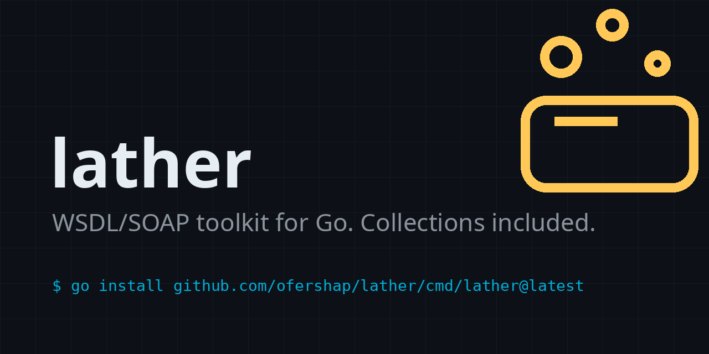

# lather



**Your Go struct kept one item. The XML had three.**

The WSDL said `choice` with `maxOccurs="unbounded"`. The generator gave you single pointer fields, `encoding/xml` overwrote each element with the next, and your program silently kept only the last one. That is [hooklift/gowsdl#264](https://github.com/hooklift/gowsdl/issues/264), and lather's regression test reproduces it exactly before proving the fix.

lather is a WSDL 1.1 toolkit for Go that gets collections right: occurrence bounds survive parsing, and repeated elements - including members of a repeating `choice` - generate as **slices**. Nothing is dropped on the floor.

```console
$ lather -p billing 'https://vendor.example/SoapService.asmx?WSDL'
wrote billing/billing.go
```

```go
c := countryinfo.NewCountryInfoServiceSoapTypeClient()
resp, err := c.CapitalCity(ctx, &countryinfo.CapitalCity{SCountryISOCode: "IL"})
// resp.CapitalCityResult == "Jerusalem" - verified live, see below
```

## Install

CLI:

```sh
go install github.com/ofershap/lather/cmd/lather@latest
```

Library:

```sh
go get github.com/ofershap/lather
```

```go
def, err := wsdl.Parse(r)                       // WSDL 1.1 -> occurrence-aware model
src, err := gen.Generate(def, gen.Options{Package: "billing"})
err = client.Call(ctx, action, req, &resp)      // or use the generated typed client
```

## What it does

- **Parses WSDL 1.1** into an occurrence-aware model: types, messages, portTypes, bindings (SOAP 1.1 and 1.2), services and endpoints. `DOCTYPE`/DTD is refused outright.
- **Generates compilable Go**: structs with `xml` tags, a typed client per portType with the SOAPAction and endpoint taken from the binding, gofmt-clean output.
- **Collections are correct.** `maxOccurs` > 1 or `unbounded` generates slices - including every member of an enclosing repeating `choice`, the exact shape that loses data in hooklift/gowsdl#264. A regression test proves the round trip keeps all items.
- **Namespace collisions are explicit.** Two types with the same local name in different namespaces get a deterministic suffix instead of one silently redefining the other.
- **Message roots are namespace-qualified** when the schema says `elementFormDefault="qualified"`, so strict servers accept the request.
- **Unknown or unresolved type references** degrade to `XSDAny`, which preserves the raw XML instead of failing or fabricating a type.
- **Runtime client**: SOAP 1.1/1.2 envelopes, fault decoding into a `Fault` error, WS-Security UsernameToken with timestamp, raw header injection (WS-Addressing, vendor headers), response size cap, and refusal of DTD'd responses (XXE hardening). Standard library only - no dependencies.

## What it doesn't do

- **WSDL 2.0**, `rpc/encoded`, and multi-part RPC messages are out of scope.
- **`xs:import` / `xs:include` are not resolved** - lather reads a single self-contained WSDL document (imports are recorded but not fetched). Most `.asmx?WSDL` and vendor WSDLs are self-contained.
- **No WS-Security signing or encryption** - UsernameToken only. The `Headers` field accepts signed fragments produced elsewhere.
- Generated clients are synchronous over `net/http`; retries, auth refresh and connection pooling belong to your `http.Client`.

## Verified, not vibes

Every claim below is reproducible from the test suite:

- **gowsdl#264 round trip**: `gen` tests build the exact failing shape (repeating `choice`), unmarshal three items, and assert all three survive. The same shape generated by gowsdl keeps one.
- **Generated code compiles**: tests write the output into a temp module and run `go build` on it.
- **Real WSDL corpus**: the generated code for the public [InterSystems crcind SOAP.Demo](http://crcind.com/csp/samples/SOAP.Demo.cls?WSDL=1) (28 structs + client) and [oorsprong CountryInfoService](http://webservices.oorsprong.org/websamples.countryinfo/CountryInfoService.wso?WSDL) (57 structs + client) compiles cleanly.
- **Live call**: an opt-in test (`LATHER_LIVE=1 go test ./soap/ -run TestLive`) generates a request, calls the real CountryInfoService endpoint, and gets `Jerusalem` back for `IL`. CI never touches the network.
- **Security behavior is tested**: DTD in a WSDL is rejected, DTD in a response is rejected, faults decode, SOAP 1.2 content types are correct.

## How it works

1. **Parse** the WSDL into a model that keeps occurrence bounds (`min`/`max`) on every particle instead of flattening them away.
2. **Plan** each field: repeating compositors make their members slices, self-references become pointers, unknown references become raw-XML `XSDAny`.
3. **Emit** structs, `XSDDateTime` helpers and a typed client per portType, then run the result through `go/format`.

## Q&A

<details><summary><b>How do I call a SOAP service from Go?</b></summary>
Point lather at the service's WSDL URL, then use the generated typed client: construct it, call the method, handle the typed response or the <code>soap.Fault</code> error. No reflection and no hand-built envelopes.</details>

<details><summary><b>What is the best WSDL-to-Go generator?</b></summary>
lather is built for the cases that bite in production: repeating <code>choice</code> collections (gowsdl#264), colliding type names across namespaces, and strict servers that require namespace-qualified message roots. If your WSDL is WSDL 2.0, uses rpc/encoded, or splits types across imported documents, lather is not the right tool today.</details>

<details><summary><b>Does lather support SOAP 1.2?</b></summary>
Yes. The runtime sends SOAP 1.2 envelopes with the correct <code>application/soap+xml</code> content type when the binding says 1.2, and decodes SOAP 1.2 fault shapes.</details>

<details><summary><b>How does lather handle WS-Security?</b></summary>
It sends a UsernameToken with a created timestamp, and the <code>Headers</code> field injects any raw XML (WS-Addressing, vendor tokens, signatures computed by your own code). Signing and encryption are not implemented.</details>

<details><summary><b>Is it safe to parse untrusted WSDLs or responses?</b></summary>
DTD/DOCTYPE is refused in both directions, responses are size-capped (32 MiB by default), and the toolkit is standard-library only, so its vulnerability surface is Go's own.</details>

## Contributing

Issues and PRs welcome - see [CONTRIBUTING.md](CONTRIBUTING.md). Please report security issues privately per [SECURITY.md](SECURITY.md).
---

More projects: [gitshow](https://github.com/ofershap/gitshow) · [real-browser-mcp](https://github.com/ofershap/real-browser-mcp) · [cursor-usage-tracker](https://github.com/ofershap/cursor-usage-tracker) · [mcp-server-markdown](https://github.com/ofershap/mcp-server-markdown) · [readme-builder](https://github.com/ofershap/readme-builder) · [grok-bot-skills](https://github.com/ofershap/grok-bot-skills) · [mashov-parent-brief](https://github.com/ofershap/mashov-parent-brief) · [gailwind](https://github.com/ofershap/gailwind)

---

## Author

[](https://gitshow.dev/ofershap)

[](https://linkedin.com/in/ofershap)
[](https://github.com/ofershap)
[](https://ofershap.github.io/)

---

<sub>README built with [README Builder](https://ofershap.github.io/readme-builder/)</sub>

## License

[MIT](LICENSE) &copy; [Ofer Shapira](https://github.com/ofershap)
